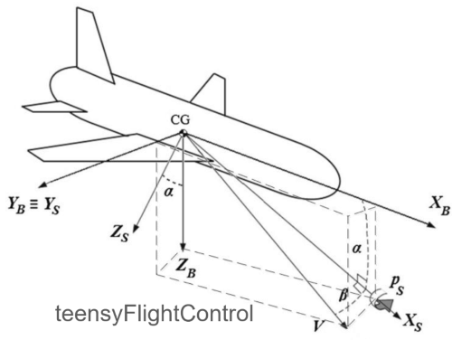

# flightControlTeensy

## 6DOF Flight Controller for use with:
- Teensy 4.0
- BNO005 6 axis IMU
- NEO 6 GPS
- Inputs (PWM)
- Servos (PWM)
- Telemetry Radio (optional hardwire)

## To-Do:
- [x] Implement MSN
- [x] Check loop timing and optimize
- [x] Calibrate limits and gains
- [x] Add visualization tool
- [x] add PyQtGraph capabilites to visualization
- [x] recolor PyQtGraph
- [x] pinInterrupt for pulseIn
- [x] pinInterup for servo commands
- [x] Check servos
- [x] Add config file for easy parameter changes
- [x] check TM with new architecture
- [x] hardware abstraction layer to make IMU, GPS, ans servo independent
- [ ] zero protected divides, common?
- [x] initialize APT params based on effector size
- [ ] initialize GDC cpp params based on input size
- [x] kalman filter for bad intermittent GPS
- [ ] time of validity for IMU, GPS, GDC commands
- [x] 'Direct' law for GDC commands
- [ ] consistent matrix naming in common
- [ ] check transformation math NAV
- [x] check lla2ecef and ecef2lla math in common
- [ ] minimize instances of variables in nav
- [x] fix method instance issue
- [ ] fix NAV alignment, add attitude
- [x] APT three loop
- [x] filtered deriv
- [x] anti windup
- [x] GPS significant figures
- [x] move transformation matrices to common
- [ ] Improve matrix definitions/overwrites
- [x] consolidate status prints?
- [x] raw tm bytes 
- [x] msnMgr, keep integral off until thrown
- [x] rename Config->CFG
- [x] interpolation mapping