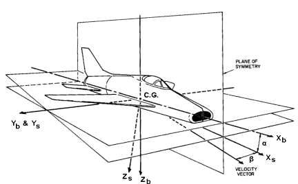

# flightControlTeensy

## 6DOF Flight Controller for use with:
- Teensy 4.0
- BNO 005
- Adafruit GPS Breakout v3
- Telemetry Radio (optional hardwire)

## To-Do:
- [x] Implement MSN
- [x] Check loop timing and optimize
- [x] Calibrate limits and gains
- [x] Add visualization tool
- [x] add PyQtGraph capabilites to visualization
- [x] recolor PyQtGraph
- [] Check servos
- [x] Add config file for easy parameter changes
- [x] check TM with new architecture
- [] hardware abstraction layer to make IMU and GPS independent
